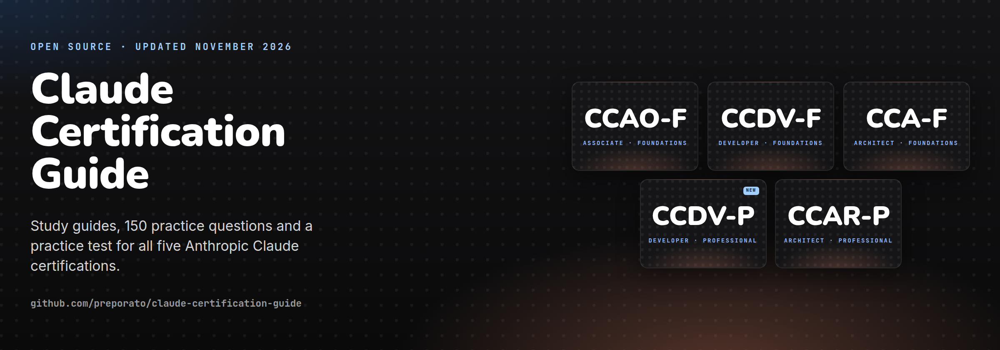
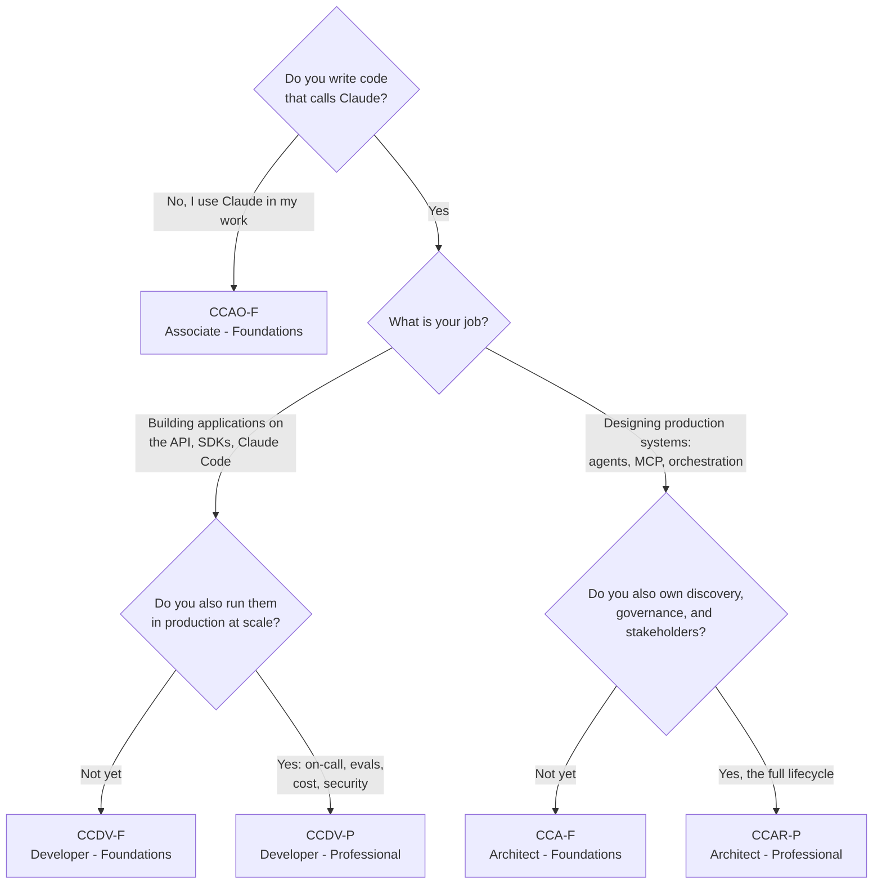

  

# Claude Certification Guide

Free study guides and practice questions for all five Anthropic Claude certifications: **CCAO-F**, **CCDV-F**, **CCDV-P**, **CCA-F** and **CCAR-P**.

- **Five complete study guides** (about 48,000 words): chapters for every exam domain, per-domain notes, worked questions, trap answers, study plans and pre-exam checklists
- **150 practice questions** with an explanation for every option, 30 per exam, spread across each exam's domains by the official weights
- **A practice test** in one HTML file ([`docs/index.html`](./docs/index.html)) that you download and open in any browser, at your own pace or timed, with a score for every domain
- **PDF and EPUB editions** of every guide, with its practice questions and answers at the back

*November 2026 update: a new guide for Developer - Professional (CCDV-P), the December 7, 2026 blueprints for CCAO-F, CCDV-F and CCAR-P, the CCA-F guide checked against Anthropic's version 1.1 exam guide (exam code CCAR-F, its six official scenarios), current Claude API and Claude Code behavior, and rebalanced practice questions. Exam facts are checked against Anthropic's official pages; see [About](#about).*

If this repo helps you prepare, a star helps the next candidate find it.

## Contents

- [Start here](#start-here)
- [The five certifications compared](#the-five-certifications-compared)
- [The December 7, 2026 changes](#the-december-7-2026-changes)
- [Which one should you take?](#which-one-should-you-take)
- [How the program works](#how-the-program-works)
- [Typical preparation timelines](#typical-preparation-timelines)
- [In this repo](#in-this-repo)
- [Free resources](#free-resources)
- [Contributing](#contributing)
- [About](#about)

## Start here

| Exam | Study guide | Practice questions | Download | Exam page with full practice tests |
|------|-------------|--------------------|----------|------------------------------------|
| [**CCAO-F**](./ccao-f/) Associate - Foundations | [Guide](./ccao-f/guide.md) | [30 questions](./ccao-f/practice-questions.md) | [PDF](./downloads/ccao-f-study-guide.pdf) · [EPUB](./downloads/ccao-f-study-guide.epub) | [preporato.com](https://preporato.com/certificates/claude-certified-associate-foundations) |
| [**CCDV-F**](./ccdv-f/) Developer - Foundations | [Guide](./ccdv-f/guide.md) | [30 questions](./ccdv-f/practice-questions.md) | [PDF](./downloads/ccdv-f-study-guide.pdf) · [EPUB](./downloads/ccdv-f-study-guide.epub) | [preporato.com](https://preporato.com/certificates/claude-certified-developer-foundations) |
| [**CCDV-P**](./ccdv-p/) Developer - Professional (new) | [Guide](./ccdv-p/guide.md) | [30 questions](./ccdv-p/practice-questions.md) | [PDF](./downloads/ccdv-p-study-guide.pdf) · [EPUB](./downloads/ccdv-p-study-guide.epub) | [preporato.com](https://preporato.com/certificates/claude-certified-developer-professional) |
| [**CCA-F**](./cca-f/) Architect - Foundations | [Guide](./cca-f/guide.md) | [30 questions](./cca-f/practice-questions.md) | [PDF](./downloads/cca-f-study-guide.pdf) · [EPUB](./downloads/cca-f-study-guide.epub) | [preporato.com](https://preporato.com/certificates/claude-certified-architect) |
| [**CCAR-P**](./ccar-p/) Architect - Professional | [Guide](./ccar-p/guide.md) | [30 questions](./ccar-p/practice-questions.md) | [PDF](./downloads/ccar-p-study-guide.pdf) · [EPUB](./downloads/ccar-p-study-guide.epub) | [preporato.com](https://preporato.com/certificates/claude-certified-architect-professional) |

The last column links to each exam's page on Preporato, which maintains this repo: free sample questions, then full-length timed practice tests (paid) in the exam's format.

## The five certifications compared

| Code | Certification | Price | Questions | Audience | Level |
|------|---------------|-------|-----------|----------|-------|
| [CCAO-F](./ccao-f/) | Claude Certified Associate - Foundations | $99 | 70, 60 scored (60 through Dec 6) | Business professionals using Claude as a productivity tool | Foundations |
| [CCDV-F](./ccdv-f/) | Claude Certified Developer - Foundations | $125 | 70, 60 scored (53 through Dec 6) | Engineers building applications on the Claude API and SDKs | Foundations |
| [CCA-F](./cca-f/) | Claude Certified Architect - Foundations | $125 | 60 | Builders of production-grade Claude and agent systems | Foundations |
| [CCDV-P](./ccdv-p/) | Claude Certified Developer - Professional | $175 | 70, 60 scored | Engineers who operate Claude systems in production at scale | Professional |
| [CCAR-P](./ccar-p/) | Claude Certified Architect - Professional | $175 | 70, 60 scored (63 through Dec 6) | Solution architects owning the full Claude solution lifecycle | Professional |

Every exam shares the same skeleton: **120 minutes** to answer (plan for about 135 minutes of seat time), delivery through **Pearson VUE** (test center or online proctored), scaled scoring from 100 to 1000 with a **720 passing bar**, offered in **English and Japanese**, and scenario-based multiple-choice and multiple-response items, each stating how many responses to select. Where an exam has 70 questions, 10 are unscored trial items you can't tell apart from the rest.

CCA-F's current exam guide (version 1.1, November 2026) gives its code as **CCAR-F**; this repo keeps CCA-F, the name most candidates know it by.

The cleanest way to read the table is as two tracks with a shared entry point:

- **The developer track:** CCDV-F certifies that you can build on the Claude platform; CCDV-P certifies that you can run what was built in production, with observability, incident response, release evaluation, cost control and security.
- **The architect track:** CCA-F certifies that you can build a system correctly; CCAR-P certifies that you can own the entire solution, from discovery through governance and stakeholder sign-off.
- **CCAO-F** sits beside both: the one exam for people who use Claude in their work rather than build with it.

## The December 7, 2026 changes

Exams taken on or after **December 7, 2026** follow updated exam guides for three certifications. The guides and practice questions in this repo follow the new versions, and each guide has a section summarizing the old blueprint for anyone testing before then.

| Exam | Through December 6 | From December 7 |
|------|--------------------|-----------------|
| CCAO-F | 60 questions, seven domains | 70 questions (60 scored), six domains |
| CCDV-F | 53 questions, eight domains | 70 questions (60 scored), same eight domains with new weights |
| CCAR-P | 63 questions, seven domains | 70 questions (60 scored), same seven domains with new weights |

CCA-F and CCDV-P are not part of the update. Anthropic's advice is to prepare with the guide that matches your exam date.

## Which one should you take?

Match the exam to your role. There are no prerequisites and no required order.

| If you are... | Take | Why | Start here |
|---|---|---|---|
| A business professional using Claude: marketing, ops, PM, comms, analysis | [CCAO-F](./ccao-f/) | The one exam with no code; covers the product you actually use | [Study guide](./ccao-f/guide.md) |
| An engineer building applications on the Claude API, SDKs, or Claude Code | [CCDV-F](./ccdv-f/) | Certifies platform depth: API mechanics, agents, tools, evaluation | [Study guide](./ccdv-f/guide.md) |
| A senior or platform engineer who keeps Claude systems healthy in production | [CCDV-P](./ccdv-p/) | Operations at scale: reliability, observability, incidents, eval gates, guardrails, coding-agent fleets | [Study guide](./ccdv-p/guide.md) |
| A builder of production Claude systems: agent architectures, MCP servers | [CCA-F](./cca-f/) | Implementation-level architecture, scenario-based format | [Study guide](./cca-f/guide.md) |
| The architect accountable for the whole solution lifecycle, 3+ years experience | [CCAR-P](./ccar-p/) | Adds discovery, governance, evaluation, and stakeholder ownership | [Study guide](./ccar-p/guide.md) |

**Stacking:** combinations make sense when they certify different parts of one job. CCDV-F + CCDV-P and CCA-F + CCAR-P are the two Foundations-to-Professional paths, and CCDV-F + CCA-F suits engineers who both build applications and design systems, with enough blueprint overlap (MCP, prompting, Claude Code) that the second exam costs meaningfully less study time. CCDV-P's guide treats CCDV-F's scope as assumed knowledge.

**For partner organizations:** CCDV-F, CCDV-P, CCA-F and CCAR-P count toward your organization's tier in the Claude Partner Network. CCAO-F doesn't count toward tier eligibility.

## How the program works

- **Who can register.** Registration runs through the Anthropic Partner Academy and is open to people who work at Claude Partner Network organizations. You sign in with a company email on a domain listed in your organization's partner record; personal addresses don't work, and people outside the network can't register. Since November 12, 2026 you register in the Partner Academy and pay at Pearson's checkout. The Anthropic Academy, the public course catalog, teaches much of the same material, and its courses end with a certificate of completion, which is a separate thing from a certification.
- **Prices.** $99 for CCAO-F, $125 for CCDV-F and CCA-F, $175 for CCDV-P and CCAR-P, per attempt. Select, Preferred and Global Premier partners get 50% off, and Global Premier partners take every exam free through December 31, 2026.
- **Delivery and languages.** Pearson VUE proctors every exam, at a test center or online from home (OnVUE), with identity verification either way. All five exams are offered in English and Japanese; one registration covers both, and you choose the language when you schedule. Candidates must be at least 18.
- **Scoring.** Scaled from 100 to 1000, with 720 to pass on all five exams. Scaled scoring adjusts for difficulty differences between exam forms, so 720 means the same standard on every form. Your score report includes a percent-correct breakdown per domain.
- **Rescheduling and retakes.** You can reschedule or cancel an OnVUE exam up to 1 hour before the appointment and a test center exam up to 48 hours before; later changes forfeit the fee. Every attempt costs the full fee, and partner discounts apply to retakes the same way. After a failed attempt you wait 14 days; after a second, 30 days; after a third, 90 days. You can take the same exam at most four times in any 12 months.
- **Practice exam.** Anthropic retired its official practice exam when the exams moved to Pearson VUE; the sample questions in each official exam guide are what remains. This repo has [30 practice questions per exam](#start-here).
- **Credentials and renewal.** Passing earns a Credly badge employers can verify, valid for 12 months. Before it expires, you renew it free by passing an open-book online assessment on the Partner Academy, which extends it 12 months from your current expiration date. If the credential lapses, getting it back means a full proctored exam at full price, so set a renewal reminder for month ten on the day you pass.

## Typical preparation timelines

| Certification | Typical prep | Baseline that timeline assumes |
|---------------|-------------|-------------------------------|
| CCAO-F | ~3 weeks | Regular, hands-on use of Claude at work |
| CCDV-F | ~4 weeks | 1-5 years engineering, 6+ months Claude or LLM work |
| CCA-F | ~30 days | 6+ months building with the Claude API, Agent SDK, Claude Code, and MCP |
| CCDV-P | ~6 weeks | CCDV-F-level knowledge, and at least one tool-using agent deployed in production |
| CCAR-P | ~6 weeks | 3+ years architecture, 6+ months production Claude or LLM solutions |

Whichever exam you choose, the preparation pattern is the same four layers:

1. **Official courses and the exam guide** on the Anthropic Partner Academy define the vocabulary the exam uses.
2. **Primary sources**: [the Claude Developer Platform docs](https://platform.claude.com/docs) and [the Claude Code docs](https://code.claude.com/docs) for the technical exams, the Claude Help Center for CCAO-F.
3. **Build or use the real thing.** Every exam writes its questions from production judgment rather than trivia.
4. **Calibrate with practice questions under timed conditions**, and let per-domain results direct your remaining study time. Start with this repo's 30 questions per exam; full-length timed tests for each exam are on its page at preporato.com: [CCAO-F](https://preporato.com/certificates/claude-certified-associate-foundations) · [CCDV-F](https://preporato.com/certificates/claude-certified-developer-foundations) · [CCDV-P](https://preporato.com/certificates/claude-certified-developer-professional) · [CCA-F](https://preporato.com/certificates/claude-certified-architect) · [CCAR-P](https://preporato.com/certificates/claude-certified-architect-professional).

## In this repo

Every exam directory holds a summary README, a **complete study guide** (chapters for every exam domain, per-domain exam notes, worked questions with explanations, trap-answer patterns, a study plan and a pre-exam checklist) and **30 practice questions**:

| Exam | Guide | Code examples | Worked questions | Practice questions | Length |
|------|-------|---------------|------------------|--------------------|--------|
| [CCAO-F](./ccao-f/guide.md) | 6 chapters | None (non-technical exam; worked text scenarios instead) | 12 | [30](./ccao-f/practice-questions.md) | ~7,900 words |
| [CCDV-F](./ccdv-f/guide.md) | 8 chapters | 11 | 15 | [30](./ccdv-f/practice-questions.md) | ~10,600 words |
| [CCDV-P](./ccdv-p/guide.md) | 8 chapters | None (operations exam; tables and evidence-based scenarios) | 12 | [30](./ccdv-p/practice-questions.md) | ~8,500 words |
| [CCA-F](./cca-f/guide.md) | 8 chapters | 17 | 12 | [30](./cca-f/practice-questions.md) | ~10,100 words |
| [CCAR-P](./ccar-p/guide.md) | 8 chapters | 7 | 15 | [30](./ccar-p/practice-questions.md) | ~10,800 words |

The rest of the repo:

- [`downloads/`](./downloads/): PDF and EPUB editions of every guide, with its practice questions and an answer key at the back
- [`practice/`](./practice/): the question banks in JSON, the single source for the practice pages and the practice test
- [`docs/`](./docs/): the practice test, one self-contained HTML file; download it and open it in any browser, offline included
- [`scripts/`](./scripts/): the build scripts for the practice pages, the practice test and the downloads
- [`PASSED.md`](./PASSED.md): people who passed with help from this repo

## Free resources

- Official exam guides, prep courses and registration for partner staff: the Anthropic Partner Academy pages for [CCAO-F](https://anthropic-partners.skilljar.com/claude-certified-associate-foundations-certification) · [CCDV-F](https://anthropic-partners.skilljar.com/claude-certified-developer-foundations-certification) · [CCDV-P](https://anthropic-partners.skilljar.com/claude-certified-developer-professional-certification) · [CCA-F](https://anthropic-partners.skilljar.com/claude-certified-architect-foundations-certification) · [CCAR-P](https://anthropic-partners.skilljar.com/claude-certified-architect-professional-certification)
- Official Anthropic Academy courses, open to everyone ([full catalog](https://anthropic.skilljar.com/)): [Claude 101](https://anthropic.skilljar.com/claude-101), [Building with the Claude API](https://anthropic.skilljar.com/claude-with-the-anthropic-api), [Claude Code 101](https://anthropic.skilljar.com/claude-code-101), [Introduction to MCP](https://anthropic.skilljar.com/introduction-to-model-context-protocol), [AI Fluency](https://anthropic.skilljar.com/ai-fluency-framework-foundations), and more; each exam's guide maps the relevant ones to its domains
- Practice questions: 30 per exam in this repo, plus free sample questions on each exam's page at preporato.com: [CCAO-F](https://preporato.com/certificates/claude-certified-associate-foundations) · [CCDV-F](https://preporato.com/certificates/claude-certified-developer-foundations) · [CCDV-P](https://preporato.com/certificates/claude-certified-developer-professional) · [CCA-F](https://preporato.com/certificates/claude-certified-architect) · [CCAR-P](https://preporato.com/certificates/claude-certified-architect-professional)
- In-depth written guides: [the Claude certifications compared](https://preporato.com/blog/claude-certifications-complete-guide-2026), plus a complete guide, study plan, cheat sheet, and domain breakdown per exam (linked in each directory)

## Contributing

Exam blueprints change and this program is young. If you spot something outdated or wrong, [report it](https://github.com/preporato/claude-certification-guide/issues/new?template=outdated-fact.yml) or open a pull request. Practice questions live in [`practice/`](./practice/), and its README explains the format. First-person exam experiences (no NDA-covered question content, please) are welcome additions to the guides.

Passed an exam with help from this repo? [Add yourself to PASSED.md](./PASSED.md).

## About

Maintained by [Preporato](https://preporato.com), where we build full-length practice tests, 500-card flashcard decks, and auto-graded hands-on projects for these certifications.

Licensed [MIT](./LICENSE). This project is not affiliated with, endorsed by, or sponsored by Anthropic. Claude is a trademark of Anthropic, PBC. Exam facts (prices, question counts, domains, policies) reflect the program as of November 2026 and may change; the Partner Academy is authoritative. The practice questions were written for this repo and are not taken from any exam.
